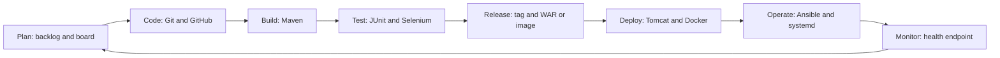

# Task 2: Agile Planning and DevOps Workflow

## User stories and acceptance criteria
| ID | Story | Acceptance criteria (Given / When / Then) |
|---|---|---|
| US1 | As a passenger, I submit a complaint so that my luggage issue is recorded | Given the form is open, when I enter valid data and submit, then I see a unique reference number |
| US2 | As a passenger, I upload a document so that I can support my claim | Given a JPG/PNG/PDF under 2 MB, when I submit, then it is stored; otherwise an error is shown |
| US3 | As the system, I validate input so that bad data is rejected | Given an invalid PNR/phone/email, when I submit, then a clear message appears next to the field |
| US4 | As a passenger, I track status by reference so that I need not call | Given a valid reference, when I search, then I see status, type, date and comment; unknown reference shows "not found" |
| US5 | As a reviewer, I log in and see complaints so that I can work the queue | Given valid credentials, when I log in, then I see the complaint list with a status filter |
| US6 | As a reviewer, I approve or reject with a comment so that the passenger gets a decision | Given an open complaint, when I choose a decision and comment, then the status changes and history is recorded |
| US7 | As ops, I see a health endpoint so that deployments can be verified | Given the app is running, when I call /actuator/health, then it returns UP |

## Product backlog
| ID | Item | Priority | Estimate (h) | Sprint |
|---|---|---|---|---|
| 1 | Repository and project setup | High | 2 | 1 |
| 2 | Complaint entity and DB | High | 2 | 1 |
| 3 | Submission form | High | 3 | 1 |
| 4 | Validation | High | 2 | 1 |
| 5 | Document upload | Medium | 2 | 1 |
| 6 | Reference number | High | 1 | 1 |
| 7 | Tracking page | High | 2 | 2 |
| 8 | Reviewer login | High | 2 | 2 |
| 9 | Pending list and filter | Medium | 2 | 2 |
| 10 | Approve / reject | High | 3 | 2 |
| 11 | Status history | Medium | 2 | 2 |
| 12 | Error pages | Low | 1 | 2 |
| 13 | Health endpoint | Medium | 1 | 3 |
| 14 | Selenium tests | High | 4 | 3 |
| 15 | Documentation and scripts | High | 4 | 3 |

## 15-card Kanban board
Columns: **To Do | In Progress | Review | Done**. One card per backlog item above (use GitHub Projects or Trello). Screenshot the board at the start and again with every card in Done.

## Sprint plan
| Sprint | Goal | Items |
|---|---|---|
| 1 | Passenger can submit a valid complaint | 1-6 |
| 2 | Reviewer can decide; passenger can track | 7-12 |
| 3 | Quality, pipeline and documentation | 13-15 |

## Definition of Done
- Code is in a feature branch and merged by pull request with at least one review comment
- `mvn clean package` succeeds and unit tests pass
- Jenkins build is green
- Selenium journeys pass
- Merged into `develop`, documented, board card moved to Done

## DevOps lifecycle

Render at mermaid.live and export a PNG for the report.
