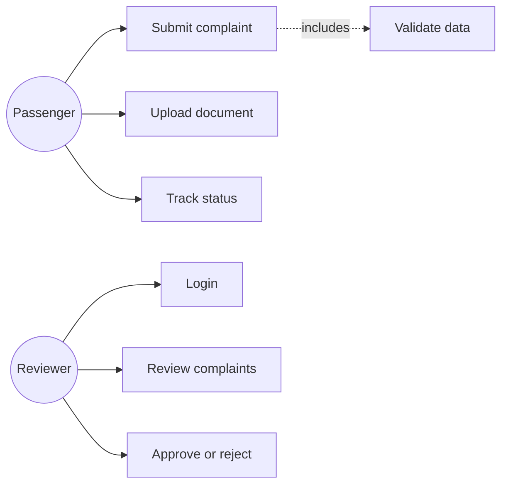
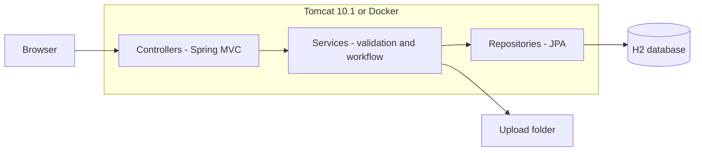
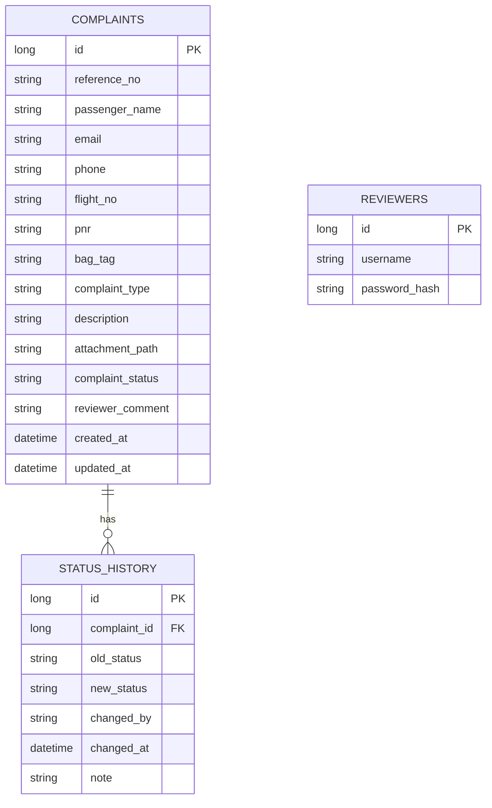

# Task 3: Requirements, Architecture and Technology Setup

## SRS summary
**Functional:** FR1 submit complaint; FR2 validate data and document; FR3 unique reference number; FR4 track status; FR5 reviewer login; FR6 list/filter complaints; FR7 approve/reject with comment; FR8 status history; FR9 health endpoint.
**Non-functional:** responses under 3 s; passwords stored as BCrypt hashes; only reviewers can open /reviewer/**; uploads renamed randomly and limited to JPG/PNG/PDF 2 MB; runs on Tomcat 10.1 or with `java -jar`; configuration by environment label.

## Technology
Java 17, Spring Boot 3.3, Thymeleaf, Spring Data JPA, H2, Spring Security, Maven, Tomcat 10.1, JUnit 5, Selenium 4, Jenkins, Docker, Ansible.

## Use cases


## Architecture


## Data model

Status flow: `SUBMITTED -> UNDER_REVIEW -> APPROVED | REJECTED`

## Routes
| Method | Path | Purpose | Access |
|---|---|---|---|
| GET | / | Home | Public |
| GET | /complaints/new | Submission form | Public |
| POST | /complaints | Submit | Public |
| GET | /complaints/success?ref= | Confirmation | Public |
| GET | /track?ref= | Track status | Public |
| GET/POST | /login | Reviewer login | Public |
| GET | /reviewer/complaints?status= | List | Reviewer |
| GET | /reviewer/complaints/{id} | Details (sets UNDER_REVIEW) | Reviewer |
| POST | /reviewer/complaints/{id}/decision | Approve/reject | Reviewer |
| GET | /actuator/health | Health | Public |
| GET | /actuator/info | Build info | Public |

## Local setup
```bash
mvn spring-boot:run      # http://localhost:8081
```
